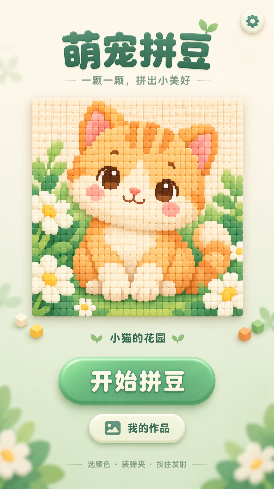
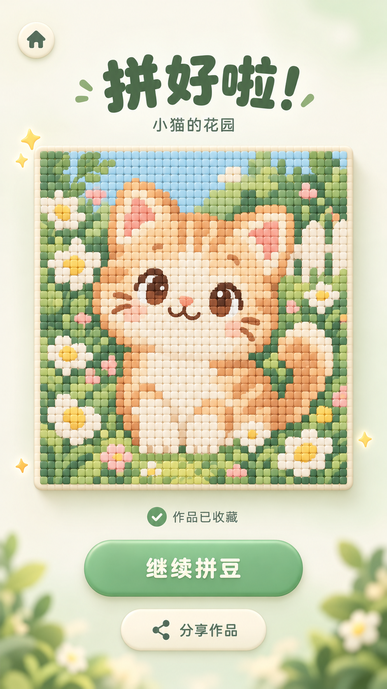

# 萌宠拼豆

Cocos Creator **3.8.8** 手机竖屏拼豆原型。当前关卡为“小猫的花园”，80×80、6400颗，使用20色色板，支持手动装填与全自动逐排发射。

## 游戏玩法

一颗一颗，拼出小美好。选择当前行需要的颜色，将色豆装入弹夹，再按住发射；豆子会依次飞向对应的格子，逐排完成整张作品。也可以开启全自动，观看装填、发射、换夹与换排的完整过程。

## 运行流程

### 1. 下载并打开项目

先安装 **Cocos Creator 3.8.8**。通过 Git 下载项目，也可以在 GitHub 点击 **Code → Download ZIP**，解压后打开。

```powershell
git clone https://github.com/870491465/mengchongpd.git
```

在 Cocos Dashboard 中选择添加已有项目，选中包含 `package.json` 的项目根目录，用3.8.8打开。等待首次资源导入与脚本编译完成，再打开 `assets/scenes/RowPrototype.scene` 并点击预览。直接运行Cocos场景不需要执行Python图片生成脚本。

下方三张页面图片是本项目的 **UI参考设计图**，用于展示首页、玩法与结算的界面方向。当前可运行版本采用80×80小猫矩阵、20色色板和全自动模式；玩法参考图仍是早期小鸡与10色色板，首页参考图中的“我的作品”入口当前隐藏。

### 2. 首页进入关卡

预览启动后进入“萌宠拼豆”首页。点击 **开始拼豆** 进入当前关卡“小猫的花园”；右上角设置可开关音效。

<p align="center">
  
</p>

### 3. 装填与逐排发射

游戏从最下方一排开始，自下向上拼完整张图。

1. **选颜色**：选色栏始终显示20种颜色。当前行需要且尚未装填的颜色可以点击，其余颜色显示灰度并禁用。
2. **装弹夹**：点击颜色后生成当前行所需数量的豆子，按点击顺序进入5个装填位。同色在当前行不能重复装填，至少装好一夹就能发射。
3. **按住发射**：首颗上膛后按住发射按钮，豆子逐颗射出，同色目标从左到右归位。当前弹夹用尽后自动换夹。
4. **松手暂停**：松手后停止新增发射，已射出的豆子继续归位。松手后可以继续装填本行剩余颜色；发射期间不能新装弹夹。
5. **自动换排**：当前行全部归位且最后空夹退出后，进入上一排，选色栏随本行所需颜色更新。

<p align="center">
  
</p>

想快速体验完整流程，点击 **全自动**：系统会自动选择当前行所需颜色、分批装填、发射并换排。再次点击 **停止自动** 可暂停；在途豆继续归位。切后台会停止自动模式，返回后需要手动重新开启。

枪头上的射速入口提供 **0.5× / 1× / 2×** 发射倍率。右上设置还可调整装夹、补位上膛、飞行、击中、后坐和音量，开启动作慢放，或重置本排、重置整图、返回首页。游戏中返回首页会保留当前进度，再次进入可继续。

### 4. 完成作品与结算

6400颗豆子全部归位、在途清零、最后空夹退出并完成反馈后，自动进入成功结算页。结算展示本局真实完成的80×80矩阵；参考图中的小猫仅用于展示页面布局。

<p align="center">
  
</p>

- **作品收藏**：完成记录写入本机存储，保存成功后才显示“作品已收藏”；保存失败可点击重试。重复进入结算不会重复保存相同矩阵。
- **继续拼豆**：当前只有一关，无下一关时返回首页。再次点击开始会开启新一轮。
- **返回首页**：左上角首页按钮返回首页，保留已经保存的完成记录。
- **分享作品**：用户点击后，在支持文件分享的浏览器中打开系统分享面板；其他浏览器导出PNG供自行分享。原生平台和小游戏平台的专用分享SDK尚未接入。

### 5. 重新体验或更新代码

想重玩时，可在游戏设置里选择重置本排或整图。修改代码或拉取更新后，先停止旧预览，等待脚本和素材导入完成，再重新启动场景；浏览器预览页也需要刷新。

## 代码与资源

- `assets/scripts/RowModel.ts`：逐排模拟、目标预占、弹药计数、换夹和自动模式。
- `assets/scripts/RowPrototype.ts`：游戏场景、触摸与动画展示。
- `assets/scripts/HomeScreen.ts`、`SuccessScreen.ts`：首页与成功结算页。
- `assets/scripts/PictureData.ts`：当前80×80矩阵与关卡名称。
- `assets/resources/`：实际运行素材、临时音效和合成棋盘贴图。
- `docs/`：原始设计说明、UI参考与小猫源图。
- `doc/`：启动、页面接入、验证与性能优化记录。

静态拼图使用同矩阵合成贴图，游戏保留当前行80颗实时豆及飞行豆。手工修改矩阵或色板后，运行 `python tools/bake-picture.py` 同步贴图。Python脚本需要 Pillow。

从猫源图重新采样：

```powershell
python tools/create-cat-picture.py --size 80
```

## 验证

以下脚本使用Node.js执行模拟与场景代码检查。脚本默认寻找Windows标准安装位置的Creator 3.8.8；其他安装位置可设置 `COCOS_EDITOR`（编辑器目录）和 `COCOS_TSC`（该编辑器内TypeScript的tsc.js路径）。

```powershell
node tools/test-initialization.cjs
node tools/test-row.cjs
node tools/test-picture.cjs
node tools/test-auto.cjs
node tools/test-home.cjs
node tools/test-success.cjs
node tools/test-row-render.cjs
node tools/test-render-performance.cjs
python tools/test-picture-texture.py
```

这些检查包括延迟资源加载、6400颗完整发射、换排、暂停、重置、收藏与节点预算。CPU场景代码检查不能代替Creator/GPU或手机验收；实际设备帧率、安全区、系统分享仍需实测，详见 `design-qa.md`。

`library/`、`temp/`、`build/` 等生成目录不提交；设计资源原压缩包已解压，因此不重复提交ZIP。

## 联系作者

欢迎扫码添加个人微信，交流拼豆玩法、Cocos Creator开发与项目建议。

<p align="center">
  
</p>

展示图片保存在 [docs/readme](docs/readme/README.md)。替换对应文件后，README会使用更新后的图片。
