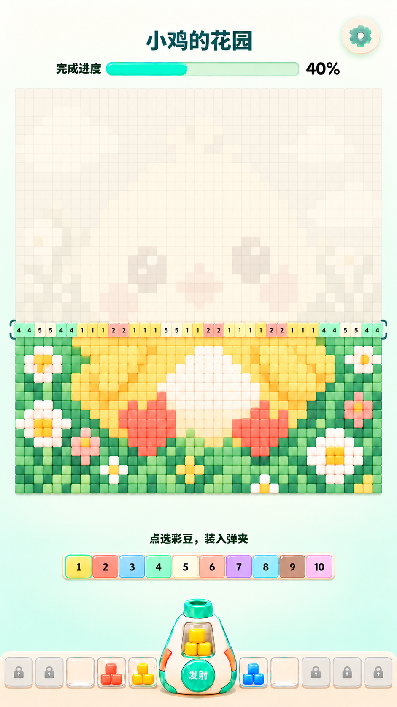
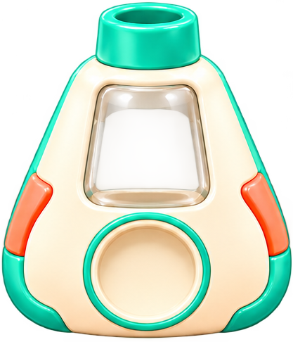

# 拼豆小游戏 UI 资源与 Cocos 开发说明 V2

本包以 reference/approved_ui.png 为最新布局与视觉基准，替代此前六瓶版资源说明。交付的是图片资源与开发交接文件，不是已验证运行的 Cocos 工程。透明组件按效果图重绘后切片，非原始设计工程的无损分层导出。小鸡完整原画为同风格补绘，细节与参考图略有不同。

## 先看图片

## 资源逐图说明

### 空仓发射器

`assets/launcher_empty.png`：中心偏上透明仓可显示当前色豆。豆子放在枪身下层，枪身玻璃覆盖其上；枪仓内局部遮罩。底部圆形凹槽叠加发射按钮。

### 透明空弹夹

`assets/magazine_empty.png`：无豆子、无数字、无接口凸边。每个位置重复使用；彩豆在玻璃下层，禁止把整块玻璃染色。

### 发射按钮底图

`assets/button_fire.png`：文字“发射”另用 Label，按下缩放至0.95，禁用降低饱和度和透明度。

### 设置按钮

`assets/button_settings.png`：图标与底座合并为一张，整张可点击。

### 可染色方豆

`assets/bead_white.png`：所有弹夹、枪仓、飞行豆和成品色格使用同一方形语言；Sprite.color染色。主图格子边长贴合，不留黑缝。

### 锁定图标

`assets/icon_lock.png`：覆盖在锁定的空弹夹上，不能点击装填。

### 干净背景与关卡主图

- background_clean.png：864×1536 米白到浅薄荷渐变，不含任何 UI。铺满背景，可拉伸。
- chick_source.png：补绘的完整关卡原画，供后续调色和重新采样；不能直接当已完成游戏状态覆盖画面。
- chick_grid_complete.png：根据 level_chick.json 生成的 40×44 完整成品预览，颜色与矩阵严格一致。
- chick_grid_ghost.png：同一矩阵混入约90%米白的未完成预览。实际游戏建议按格生成，避免和动态格错位。

## 动态内容：不要制作成文字图片

标题读取 level.name，用普通无衬线中文 Label；不做立体标题或逐关图片标题。进度、颜色编号、当前排数字、提示、锁定状态均由代码控制。进度条底槽、填充、选中框、当前排边框和底部奶油托盘可使用 Graphics 或通用圆角节点生成。色条复用白豆/圆角底块染色，不烘焙10张颜色按钮。

## 布局（864×1536设计坐标，左上角为原点）

|模块|建议范围 x,y,w,h|说明|
|---|---|---|
|标题|200,55,430,64|普通字体，单行，长名称缩小或省略|
|设置|742,36,78,78|触摸范围不小于44×44|
|进度|125,132,615,36|数值动态更新|
|主图|32,192,800,880|40列×44行，每格20；不可按编号数量拉伸当前排|
|提示|200,1155,464,40|点选彩豆，装入弹夹|
|紧凑选色区|140,1205,584,52|10格紧贴；超过10色第二排向上扩展|
|发射器|342,1308,180,215|底部居中，仓里显示当前色|
|左5弹夹|10,1430,326,68|从外向内：锁、锁、空、红、黄|
|右5弹夹|528,1430,326,68|从内向外：蓝、空、锁、锁、锁|

位置为参考值，按安全区适配并保留设备比例。背景贴屏幕底，交互按钮位于系统安全区之内。实际排列5个已解锁、5个锁定；状态截图只是展示，不作为开局固定已装豆。

Cocos中心原点换算：x_cocos=x_left-432，y_cocos=768-y_top。对节点使用其矩形中心换算。竖屏优先保持主图和底部完整，长屏增加中间留白，禁止主图非等比拉伸。色块视觉可小，触摸区域可扩展但相邻区域不能重叠。

## 图层与节点

Canvas：Background → Header → BoardRoot → Palette → BottomDock → FlyBeanLayer → FeedbackLayer。
BoardRoot：GhostCells → FilledCells → CurrentRowCells → CurrentRowLabels → RowBrackets。
BottomDock：Tray → MagazineBeans（各自Mask）→ MagazineGlass → LockIcons → ChamberBeans（Mask）→ LauncherBody → FireButton → FireLabel。

枪仓Mask可先按 launcher_empty 贴图归一化范围 x=0.29..0.70、y=0.23..0.56 调整，坐标原点左上；弹夹内Mask约x=0.12..0.88、y=0.10..0.82。这些是美术预估值，须在编辑器对照边缘微调。透明外壳覆盖豆子后，内部颜色仍要清楚，禁止先画豆子后用不透明底板盖住。

## 关卡数据与渲染规则

读取 data/level_chick.json。cells[r][c]的r=0是图顶行，发射从r=43开始，完成后r--。颜色编号对应palette.id，不允许因筛选当前排而重新编号。当前行的需求数量对整行 cells[r] 做计数即可；不要写死参考图“11颗”。本示例共1760格，全格有效。

三个状态：未拼格=米白与目标色混合，目标色仅占8%–12%，轮廓隐约可见；当前格=目标色与米白混合，目标色占20%–30%，每一格显示颜色编号；完成格=主色完整显示，极浅浮雕与微弱高光。整排40格全部显示，格宽与底图完全一致，不能用独立放大色条遮盖中心局部。当前行完成的格立即换成实体豆并去掉数字，下一排等整排落位后再激活。

进度=已落位格数/总有效格数，飞行中不计入。截图40%只作参考，不把它作为默认进度。完整成品和未完成预览均由同一数据生成，避免原画与格子颜色不一致。

## 操作流程与状态

开局空仓，默认解锁5槽；只允许点选当前排仍有未装填需求的颜色。颜色条可展示全关卡颜色，但无需求项降低透明度且不可加载；若超过10色使用两行。点击一次将此颜色本排尚未分配的数量装入一个空槽，内部以小方豆展示，数量多时仅显示代表性方豆阵列，实际数量存数据；弹夹上不放数量文字。

装填按点击时间进入FIFO队列。轻压/滑入约160–220ms，选中色块短暂抬起与亮边反馈，不反复闪烁。枪仓显示队首颜色。按住发射，约每100–140ms发射1颗，松手停止生成新豆，飞行中的豆继续落位；无需瞄准或滑动。

建议MVP允许有一个已装弹夹就发射，解决一排颜色超过5种但只解锁5槽的情况，不要求全部装好再开火。此项是实现建议；如坚持全装好才可射击，关卡必须限制每行颜色不超过已解锁槽位数。

发射时先预留该颜色尚未占用的目标格，再扣除弹夹库存，防止多颗锁定同一目标。飞行180–260ms，落位轻缩放1.08→1.0约100ms；不要爆炸、强闪光或重粒子。弹夹库存归零后轻微抬起并淡出，槽恢复空置，队首接续。行内所有目标落位且inFlight=0后才切下一行，避免换行误填。触摸取消、切后台、弹窗打开时解除按住状态。

## 资源导入与实现建议

建议采用项目现有 Cocos Creator 3.x 版本和 TypeScript，不在已有项目强行升级引擎。PNG按SpriteFrame导入，保留alpha；紧密色格优先Point过滤检查边缘，设备贴图使用Linear。不要将整台枪做九宫格拉伸。字形采用项目可合法使用的中文字体或系统字体，本包未附第三方字体。音效暂未包含，仅预留ui_select、magazine_load、bean_fire、bean_land、magazine_empty、row_complete事件。

推荐脚本职责：LevelData（矩阵/颜色），BoardRenderer（格子与编号），MagazineQueue（槽位/FIFO），LauncherController（按住发射/预留），PaletteController（可选颜色/装填），GameState（进度/换行/完成）。复用对象池管理飞豆，不为每格维护独立update。几十格数字要在真机检查清晰度。

## 验收清单

1. 主图占第一视觉层级；未拼区域只能隐约辨认小鸡，完成色彩逐排揭晓。
2. 当前排从左至右完整显示，目标格和编号一一对应，色豆填入后没有洞和黑缝。
3. 弹夹/枪仓/飞豆均为同一种小方块；透明玻璃无整体染色、无数量文字。
4. 枪口固定底部中间；两侧各5槽，合计只开放5槽，其余锁定。
5. 连点同色、满槽、空仓、松手、切后台、最后一颗仍在飞时均不会多装、多射或提前换行。
6. 进度与实际落位一致；完成1760格才结算；新关卡只改数据和名称，不需重新制作标题图。

## 给 Codex 的开工提示词

请先阅读本目录README和本说明，查看reference/approved_ui.png以及资源预览。基于已有Cocos项目版本实现上述游戏页，不重设计布局，不使用旧版六瓶方案。以data/level_chick.json作为颜色、编号、需求数量、目标位置和进度的唯一来源。先完成静态布局、整排编号和透明仓内小方豆展示，再完成装填队列、按住自动飞行落位、逐排推进和结束判定。严格保留普通动态标题、干净背景、弱底图、紧密小方豆、底部中心枪与两侧各5槽。检查导入贴图透明度并调整Mask，逐条完成验收。不要把整张UI截图当作游戏背景。报告改动、验证方法与未完成项，不宣称未运行的真机验证已通过。
