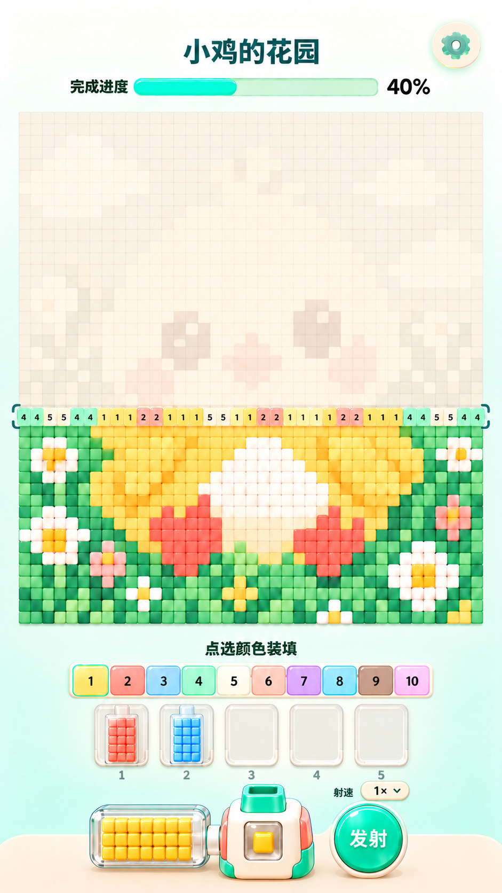
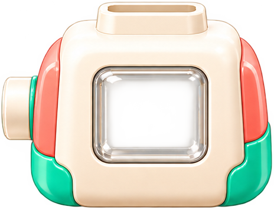
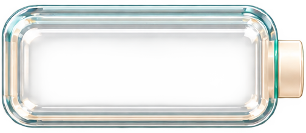
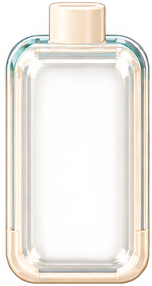
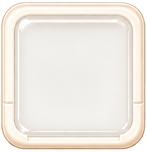
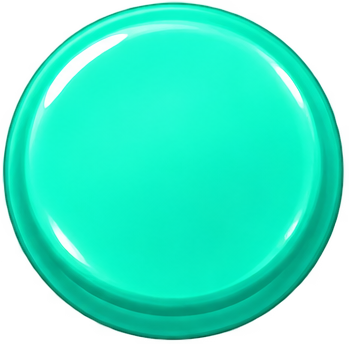

# 拼豆小游戏 V3：独立枪头、空弹夹与射速控件

## 交付范围与优先级

本包以 reference/approved_ui.png 为当前定稿，替代旧包“两侧各5槽”和“一体式锥形枪”方案。这里是设计素材与开发交接，不是已运行的 Cocos 工程。设备按最新截图重绘并拆图，非PSD原始分层；完整小鸡沿用V2补绘原画与示例矩阵，细节并非截图逐像素复刻。

先打开 图片说明.html 看图，再按本文件开发。assets中PNG均独立；asset_manifest.json记录实际像素尺寸与透明通道。

## 逐图资源说明

### 固定枪身

`assets/gun_body_empty.png`：仅枪身，无绿色枪头；正面枪仓留空透明。枪身和侧边接口不参与枪头后坐力。

### 独立枪头

`assets/gun_muzzle.png`：绿色枪口及下方短颈为独立Sprite，放在枪身后面，短颈藏入顶部底座。发射点随此节点移动。

### 枪旁横向空弹夹

`assets/magazine_active_empty.png`：横向透明无色空壳，没有彩豆和数量。右侧出口对准枪身左侧接口，连接处小幅重叠。

### 待发竖向空弹夹

`assets/magazine_queue_empty.png`：供上方已选颜色排队。内部方豆由程序放入，整组移动到枪旁时转换为横向供豆仓表现。

### 待发槽底座

`assets/queue_slot_empty.png`：横排复用5份，槽序号用Label。空槽只显示此底座。

### 射速按钮底图

`assets/speed_button_base.png`：不带字。叠加Label显示0.5×、1×、2×，默认1×；旁边射速文字也用Label。

### 发射按钮

`assets/button_fire.png`：复用薄荷圆形无字底图，发射二字另用Label。

### 设置按钮

`assets/button_settings.png`：底座与齿轮合图，可整体点击。

### 白色方豆

`assets/bead_white.png`：供颜色染色；用于弹夹、枪仓和飞行豆；主图用低浮雕紧密格子，不突出颗粒。

### 锁图标（预留）

`assets/icon_lock.png`：最新画面5槽均开放，不显示锁；仅供将来扩展使用。

## 主图与背景

background_clean.png 为864×1536米白到浅薄荷渐变，不含UI。chick_source.png是完整补绘原画；chick_grid_complete.png是40×44矩阵的完成预览；chick_grid_ghost.png是同矩阵10%目标色混米白的未拼预览。data/level_chick.json是实际格子、编号与数量的唯一来源，不能从截图OCR数字来还原关卡。

未拼格只保留8%–12%的目标色，隐约辨认小鸡；当前整排用目标色20%–30%混米白并标颜色编号；已拼格显示完整颜色、极浅浮雕、无洞无黑缝。当前排必须覆盖该行全部40格，和底图同格宽，不做放大的独立悬浮色条。

矩阵r=0在顶端，从r=43最底行向上完成。palette.id固定不重编号；当前颜色需求由整行计数产生。进度只统计落位格，不统计飞行格。总1760格，截图40%不作为默认初始状态。

## 布局：864×1536，原点左上

|模块|建议范围x,y,w,h|约束|
|---|---|---|
|标题|200,55,430,64|读取level.name，普通中文Label|
|设置|742,36,78,78|独立点击|
|进度|125,132,615,36|动态填充与百分比|
|主图|32,192,800,880|每格20，40列44行|
|选色提示|230,1100,404,36|点选颜色装填|
|紧凑选色条|125,1145,614,52|10格连排，更多颜色向上扩第二行|
|待发队列|160,1213,544,112|5槽，序号小字放下方|
|枪旁横弹夹|150,1388,216,109|透明空壳，内部程序生成豆子|
|枪身|378,1378,164,134|固定，含透明显示仓|
|独立枪头|414,1350,80,56|短颈藏进枪身顶部，中心对准枪管|
|发射按钮|578,1382,124,124|右手拇指位置，文字独立|
|射速按钮|622,1344,84,32|标称视觉尺寸，触摸高至少44|

以上是摆放起点，设备按图片比例缩放，参考图调节连接处，不要九宫格拉伸枪身。中心坐标换算x=x_left+w/2-432，y=768-y_top-h/2。底部设备贴近底托，但点击区域避开系统安全区。长屏拉开中部留白，不能挤压主图格子或扩大豆子间隙。

## 必须独立的图层

Canvas：Background → Header → Board → Palette → Queue → BottomDock → FlyingBeans → Feedback。
GunRoot下：ChamberBeans + Mask → MuzzleRoot（独立枪头）→ BodySprite（固定前壳）→ Feedback。
ActiveMagazineRoot：Beans + Mask → GlassSprite。QueueItem同样先画豆子，再覆盖透明壳；队列槽底座在最下层。

不要把枪头、枪身和横弹夹合成一张图。不要把彩豆画进空弹夹贴图。透明壳不整体染色，只通过内部方豆辨识颜色。枪仓显示当前待发的单颗方豆；下一个方豆经过接口补进来。

## 枪头后坐力

后坐力只作用于MuzzleRoot，枪身、侧弹夹、队列和按钮保持固定。正向朝上射击，后坐力沿本地Y轴向下：正常位→下移4设计像素/约25ms→回位/约55ms，总80ms。可轻微scaleY=0.96，但不做明显弹簧拉伸。短颈与枪身顶部保持至少6设计像素重叠，回缩不能露出背景裂缝。

MuzzleRoot建议中心锚点；枪管定位可对照枪身上方插口。FirePoint挂在MuzzleRoot口沿内侧上方，每次发射读取其世界坐标再转到飞豆层坐标，不能用硬编码屏幕位置。新射击前停止旧tween并以记录的初始位置重置，禁止累计偏移；松手不会打断已发射豆的落位。

## 枪仓与空弹夹的遮罩

贴图裁剪后归一化范围仅作初始参考（左上为0,0）：枪仓约x=0.34..0.74,y=0.36..0.73；横弹夹约x=0.10..0.85,y=0.19..0.76；竖弹夹约x=0.19..0.81,y=0.25..0.89。在Cocos编辑器中根据玻璃内缘微调Mask，不得裁掉边缘方豆或溢出外壳。

枪身中心显示仓略偏贴图中心右侧，因为左边有接口。枪头需对准接收器主体中心，不能直接用整张枪身PNG的几何中心盲对齐。横弹夹右出口与枪身左接口稍重叠；只保留一段短连接，不拉出长管道。

## 装填与自动补豆

1. 点击上方颜色，当前行此颜色剩余未分配数量装入一个空队列槽。选中颜色短暂压下、亮边，再出现对应方豆，反馈约160–220ms。
2. 枪旁空仓时，队首颜色自动进入横向供豆仓。竖弹夹移动到枪旁过程中，可用短交叉淡化切成横向空壳，内部彩豆跟随统一容器，不硬拉伸玻璃形状。队列其余项目前移。
3. 横仓中的小方豆依次通过右侧接口进入枪仓；枪仓当前色必须和横仓一致。
4. 按住发射，枪仓豆从枪口飞向当前排同色未填格，同时独立枪头回缩；横仓下一颗补入。松手停止新发射，已飞出的继续归位。
5. 当前颜色耗尽，横仓先确实显示为空，再让下一队列颜色接入。不得用下一色直接覆盖未耗尽豆子。上方被取走的槽变空，不在上下同时展示两份同一库存。
6. 当前排所有豆落位且inFlight=0后才出现下一排需求；最后一排完成后才结算。

发射时先预留目标格再扣库存，防止重复命中。按点击顺序FIFO，编号与颜色映射固定。可以先装部分颜色就发射，腾出槽位后继续装当前排其余颜色；示例数据部分行有8种颜色，不能要求5槽一次全装完才允许开火。

内部方豆不强求每一库存都挤在极小贴图上，数量较多时可显示代表性阵列，但扣减、清空与队列换色必须真实，弹夹外不显示数量文字。

## 射速

|档位|生成新豆间隔（建议初值）|枪头后坐力|飞行与落位|
|---|---|---|---|
|0.5×|240ms|80ms|飞行约220ms，落位约100ms|
|1× 默认|120ms|80ms|同上|
|2×|60ms|缩短至50ms|同上，允许多颗飞行但目标预留|

只调发射与补豆节奏，不改全局时间倍率、按钮动画、进度条动画。2×补豆要在下一次射击前完成，可在接口附近表现快速短位移，不能让枪仓一直空着发射。表中数值为手感起点，需原型试调。

当前UI带下箭头，建议点击展开小菜单0.5×/1×/2×；菜单选项触摸区至少44高。选择后收起并记住本次用户设置。倍速切换在下一次发射间隔生效，已发射豆维持原轨迹；菜单开启或触摸取消时解除按住状态。射速标签、倍率和箭头均用Label/Graphics实现，不做三张文字贴图。

## 资源导入与开发约束

沿用已有Cocos Creator版本，建议3.x + TypeScript。PNG保留alpha并导入SpriteFrame，设备图Linear；密集主图格子需实机检查Point/Linear边缘，不能出现黑缝。完整截图仅供对照，不作为游戏背景。通用进度底槽、填充、色条边框、底托和当前行括号用Graphics或通用圆角组件绘制，避免重复资源。

本包没有音频和第三方字体，预留select/load/feed/fire/land/empty/rowComplete事件。文字使用项目可合法使用的字体或系统字体。独立贴图尺寸见asset_manifest.json；所有连接位置和Mask仍需在引擎中对照微调。

## 验收与开工提示词

请先阅读本文件和图片说明.html，对照reference/approved_ui.png在现有Cocos项目实施。先完成静态布局、透明空仓和独立枪头连接，再完成选色排队、横仓自动补豆、按住发射、三档射速及逐排落位。旧版两侧10槽和锥形一体枪作废。本包未做Cocos运行验证，请自行编译、预览并报告实际验证结果。

验收重点：枪头后坐枪身不动；枪头接缝不漏底；横弹夹开局真空且可透色；枪仓和供豆仓颜色一致；发射时豆子数减少；一色耗尽先清空再换色；队列不复制库存；切倍率不多射漏射；当前完整一排与主图逐格对齐；所有1760格落位才完成；无滑动瞄准、火焰或真实枪械表现。
