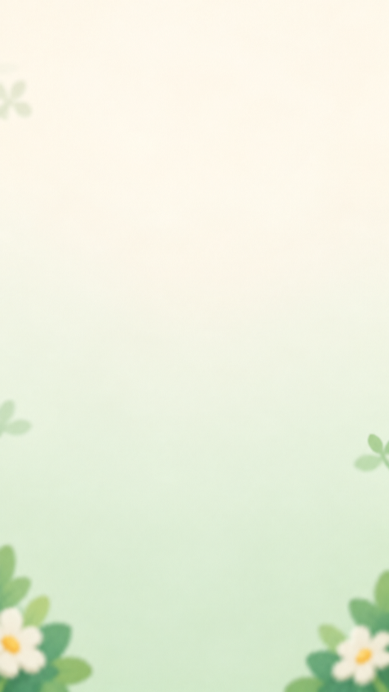
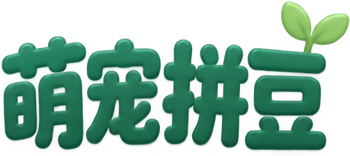
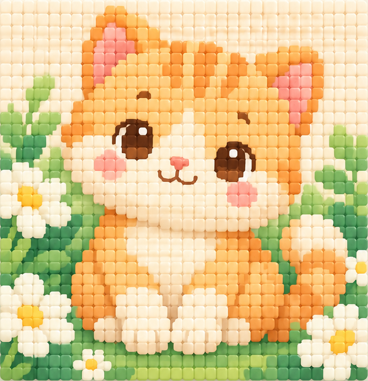
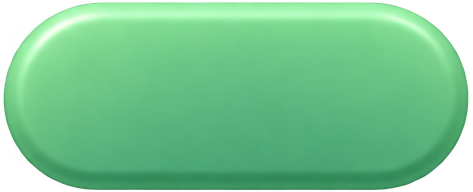
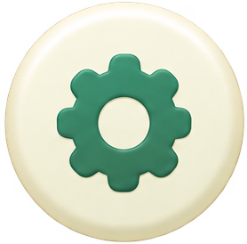
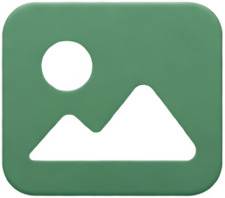
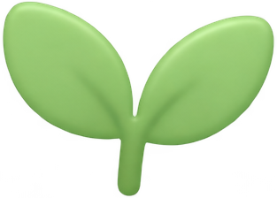

# 萌宠拼豆：首页资源说明

本包对应 reference/home_approved.png。背景与透明组件是按定稿重绘拆分，主图为原图裁切，并非原始PSD无损分层。暂未在Cocos运行验证。

## 首页背景

`background_home.png`：独立重绘的米白薄荷背景，带边缘虚化花叶，不含文字按钮。全屏等比铺满。

## 标题Logo

`title_logo.png`：萌宠拼豆固定品牌标题，带小芽；透明PNG。改名需替换此图。

## 小猫拼豆展示图

`hero_cat_beads.png`：直接裁取定稿主图区，保留原色与拼豆样式。矩形展示图，边缘有少量原图底色，非透明抠图；建议置于同色奶油底板或圆角Mask中。仅首页预览，不是关卡色格数据。

## 开始按钮底图

`button_start_base.png`：透明无字按钮；另叠加Label：开始拼豆。

## 作品按钮底图

`button_gallery_base.png`：透明无字按钮；叠加图标与Label：我的作品。

## 设置按钮

`button_settings.png`：底座与齿轮合图，可整体点击。

## 作品图标

`icon_gallery.png`：透明图片图标，与按钮分离。

## 嫩芽装饰

`icon_sprout.png`：复用在关卡名两侧；不参与交互。

## Cocos组装

设计分辨率864×1536；Canvas下顺序：Background、Logo、Tagline、Hero、LevelName、StartButton、GalleryButton、Settings、Footer。不要整张首页截图直接做背景。

参考范围以左上为原点：Logo(195,60,475,165)，Tagline(200,230,464,46)，Hero(100,307,664,687)，LevelName(280,1040,304,50)，StartButton(185,1120,494,150)，GalleryButton(280,1300,304,90)，Settings(755,30,78,78)，Footer(190,1440,484,45)。按屏幕安全区微调，图片保持比例；长屏可增加留白。使用独立Label，居中对齐，中文字体用项目已有合法字体或系统字体。

文字：副标题“一颗一颗，拼出小美好”；关卡名“小猫的花园”（读取数据）；主按钮“开始拼豆”；次按钮“我的作品”；底部“选颜色 · 装弹夹 · 按住发射”。不要将这些字烘焙进按钮。首页固定品牌可用Logo，游戏页关卡名继续用普通动态字体。

按钮默认使用当前PNG，按下整体缩放至0.96，释放回1；禁用降低透明度。设置点击范围至少44×44。我的作品入口是首页设计建议，若功能未实现先隐藏，不显示无响应按钮。开始按钮进入当前关卡，标题随level.name读取。

主图周边散落的立体方豆是可选装饰，本包未单独重绘；不影响首页功能与主体布局。背景花叶已合并在background_home，不必另建节点。主图裁切边缘若出现细底色线，可使用小圆角Mask轻微内收1–2像素。

reference/cat_source.png 是此前生成的小猫完整原画，供后续关卡采样用，不能和首页裁切图混为同一逐格矩阵。本包不新增小猫关卡数据。

## 给Codex

请按reference/home_approved.png实现首页。使用assets独立资源，阅读asset_manifest.json确认尺寸；按钮文字与关卡名采用Label。保留干净背景、大面积小猫拼豆展示、主次入口层级，不增加金币、体力、广告或商城。检查手机安全区、按钮按压反馈、长标题以及首页到游戏页跳转。资源由参考图重绘和裁切，必要时微调位置与尺寸，但不要改整体风格。
